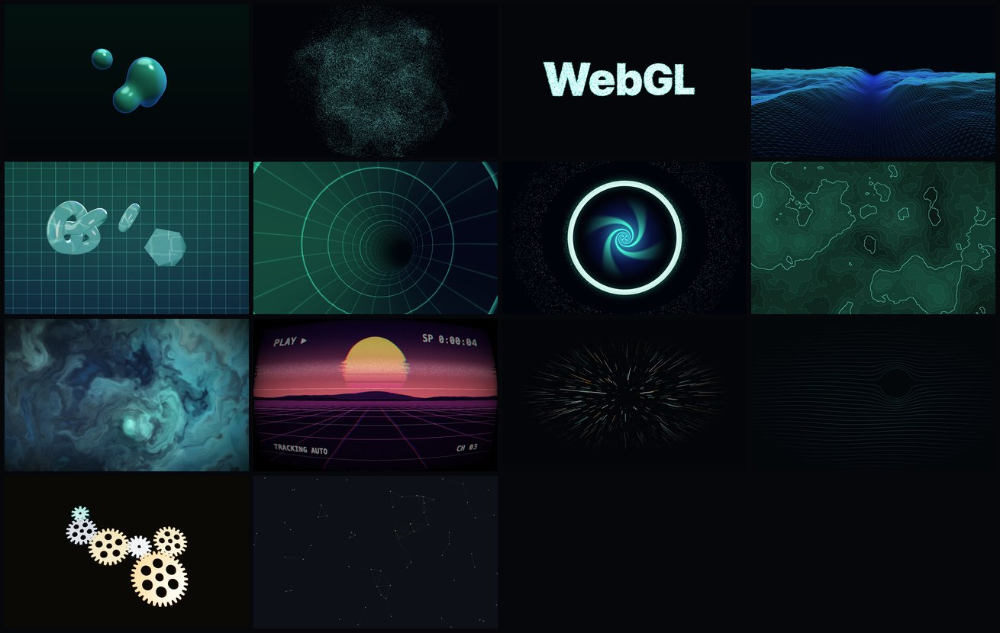

# WebGL Shader Lab

A gallery of 14 real-time WebGL shader and 3D effects built with three.js and React Three Fiber. Each one has its own page, reacts to the mouse or touch, and comes with a small control panel.

**Live demo:** [pscactux.github.io/webgl-shader-lab](https://pscactux.github.io/webgl-shader-lab/)



## Effects

| # | Effect | What it shows |
|---|--------|---------------|
| 01 | **Liquid Metal** | Raymarched metaballs blended with a smooth minimum. One drop follows the pointer. |
| 02 | **Curl Swarm** | Up to 262k particles simulated on the GPU (GPGPU) in a curl-noise flow field. Hold the pointer down to pull them. |
| 03 | **Particle Morph** | 90k particles that spell out any word. The morph runs in the vertex shader. |
| 04 | **Wireframe Terrain** | FBM terrain displaced in the vertex shader from a flat plane. You fly over it with the pointer. |
| 05 | **Glass** | Transmission material with refraction, thickness and chromatic dispersion, lit by a studio built from lightformers (no HDR file). |
| 06 | **Tunnel** | An endless flight along a closed spline tube. The sense of speed comes from the shader. |
| 07 | **Portal** | A vortex drawn in polar coordinates, with particles whose positions are worked out from time in closed form. Click to fly through. |
| 08 | **Topographic Contours** | Iso-lines of a noise height field, anti-aliased with `fwidth`. A hill follows the pointer. |
| 09 | **Aurora Gradient** | Domain-warped FBM: noise sampled at coordinates bent by more noise. |
| 10 | **VHS Tape** | A procedural retro scene run through a CRT/VHS pass with curvature, chroma bleed, tracking noise and scanlines. Click to rewind. |
| 11 | **Warp Speed** | A starfield of instanced streaks projected by hand in the vertex shader. The pointer's height sets the speed. |
| 12 | **Wave Field** | Rows of lines that swell on their own and bend away from the pointer. Click to send a ripple. |
| 13 | **Gear Train** | Extruded gears built in code, with correct ratios and teeth that line up. Drag or scroll to drive them. |
| 14 | **Constellation** | Drifting nodes that link up when they get close and reach out to the pointer. |

Use ← / → to move between effects and Esc to go back to the gallery.

## Run it

```bash
npm install
npm run dev        # http://localhost:5173
npm run build      # type-check + production build into dist/
npm run preview    # serve the build
```

Needs Node 20+ and a browser with WebGL 2.

Deploying: `.github/workflows/pages.yml` builds and publishes `dist/` to GitHub Pages on every push to `main`. In the repository settings, set Pages → Source to "GitHub Actions". The Vite `base` is relative (`./`) and routing uses the URL hash, so the same build works under `/webgl-shader-lab/` without any rewrites.

## How it works

- **Raymarching with signed distance fields** (Liquid Metal). There is no mesh, only a full-screen quad. For each pixel the shader steps along a ray, using the distance to the nearest surface as a safe step size. Normals come from the gradient of the distance field, using four samples in a tetrahedron.
- **Smooth minimum.** `smin(a, b, k)` blends two distances with a polynomial instead of taking the hard `min`, so spheres melt into each other when they get close.
- **FBM noise** (Terrain, Contours, Aurora, VHS). Several octaves of value noise, each at twice the frequency and half the amplitude of the last, with a small rotation between octaves to hide grid artifacts. Terrain runs it in the vertex shader to displace a plane. Contours draws the lines where `height × levels` crosses an integer and divides by `fwidth()`, which keeps the lines one pixel wide at any slope.
- **Domain warping** (Aurora). `fbm(p + fbm(p + fbm(p)))`. The middle steps are also reused to mix the colours.
- **GPGPU** (Curl Swarm). Particle positions and velocities live in float textures, one texel per particle. Each frame two fragment shaders read the previous textures and write the next ones (ping-pong, with three's `GPUComputationRenderer`). Velocities follow the **curl of a 3D simplex-noise field**. That field has no divergence, so the particles swirl instead of piling up.
- **Vertex-shader animation** (Particle Morph, Portal, Warp, Wave Field). The CPU uploads static attributes (start point, target, seed, phase) and the GPU works out every position from time and a few uniforms. Warp draws each star as an instanced quad and does the perspective divide itself, so it can stretch the quad between where the star is now and where it was a moment ago.
- **Post-processing in a single pass** (VHS). The scene is a function, not a texture, so the red, green and blue channels can each be evaluated at slightly shifted coordinates. Barrel curvature, per-line jitter, a rolling noise band, scanlines and grain are all added in the same shader.
- **Procedural geometry** (Gears, Tunnel). Gear outlines are 2D shapes extruded into solids. Each gear's rotation is `ratio × driver + offset`: the ratio comes from the tooth counts, and the offset puts a gap in front of the neighbour's tooth where they touch. The tunnel is a `TubeGeometry` around a closed Catmull-Rom loop, so the flight never jumps back to the start.
- **Cleanup and frame rate.** Each effect is a lazily loaded chunk with its own `<Canvas>`, keyed by route. When you leave a page, React Three Fiber disposes the scene and releases the WebGL context. Geometries, textures and GPGPU targets built by hand are disposed in effect cleanups, and the lil-gui panel is destroyed. Full-screen fragment shaders cap the device pixel ratio at 1.25–1.5. Each page shows a small FPS readout in the bottom-right corner.

## Project structure

```
src/
  App.tsx                 hash routing: gallery or effect page
  components/
    Gallery.tsx           index page with thumbnails
    EffectPage.tsx        HUD, prev/next navigation, keyboard shortcuts
    Stage.tsx             shared <Canvas> with defaults and an FPS meter
    ScreenQuad.tsx        full-screen quad for fragment-shader effects
    Reticle.tsx           custom pointer reticle
  effects/
    registry.ts           list of effects (title, hint, tags, lazy import)
    *.tsx                 one file per effect, shaders inline
  lib/
    glsl.ts               shared GLSL: hash, value noise, FBM, quad vertex shader
    gui.ts                lil-gui hooks with cleanup on unmount
    color.ts, random.ts, router.ts
public/thumbs/            gallery thumbnails
scripts/capture.mjs       headless-Chromium check that opens every effect and saves screenshots
```

## License

MIT © 2026 PSCactux
